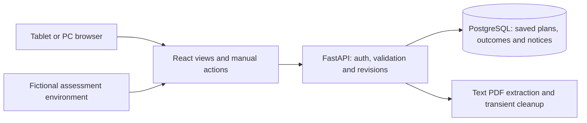
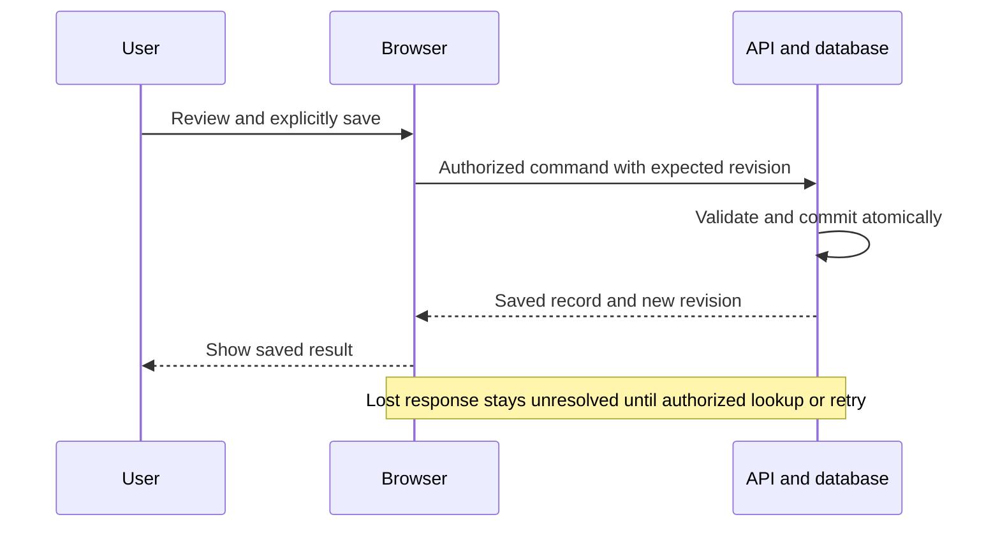

# Architecture Spine — Course V1

## Authority and structure

The owner approved [SCOPE-02](../../sprint-change-proposal-2026-10-19.md). The [current PRD](../../prds/prd-IBE160-2026-09-21/prd.md) and current UX govern. Earlier AD-1–14 are superseded as mapped below; the original is preserved in the [historical index](../../archive/pre-scope-02-2026-10-19/README.md). This is a smaller implementation contract, not completed code.

One React/TypeScript browser frontend, one Python/FastAPI modular backend and PostgreSQL. Preserve the adopted stack; verify supported, mutually compatible versions and lock actual dependencies at bootstrap. Old September version numbers are not verified executable requirements. No production or integration SQLite substitute. Choose a small migration tool in implementation and test migrations; no framework-wide scaffolding requirements.

The backend is authoritative for saved drafts, plans, manual selection/outcomes, sessions and day-associated notices. Browser memory holds form edits and current presentation only. No private IndexedDB/localStorage cache, service worker, outbox, GPS engine, writer epoch, day grant or multi-build offline recovery. A non-private manual theme preference may use localStorage.

## Boundaries and contracts

| Contract | Fields and responsibility |
|---|---|
| ImportDraft | Stable ID, authenticated owner, creation/expiry, revision, service/calendar dates, ordered typed activities, page/field uncertainty and manual corrections. No persistent original/raw extraction archive. |
| Workday | Stable ID, owner, state, revision, confirmed plan, fixed planned-end retention bound, selected activity, bus assignment and explicit manual outcomes. |
| Activity | Stable identity independent of line, source order, type, explicit dates/times, line/direction/destination for trips, known endpoints/places, vehicle duty separate from bus, nullable nonessential facts. |
| ManualNotice | Stable ID, workday ID, title, explicit line tags, original-source URL, nullable validity/source-update time, separate entered/checked time, explicit status. No inferred version lifecycle. |
| SaveResult | Stable operation ID, accepted record ID/revision and server time; errors identify invalid/unauthorized/expired/conflict/unavailable. A lost response is not a failed commit assertion. |

Use UUIDs, server-derived owner, UTC instants plus Europe/Oslo service/calendar interpretation. Typed request/response schemas are validated server-side; generated TypeScript types may help but do not replace validation. External source IDs are not needed for manual selection. Keep manual and source facts distinct.

Ordinary application modules own their writes. PDF interpretation is an actual external boundary behind a small adapter. Do not introduce transit/source integration ports for deferred functionality. Use a small testable lifecycle module, not the previous sensing/context engine.

## Online writes and lifecycle

Draft → confirmed → active → ended/aborted occurs by explicit actions. A new draft cannot replace a confirmed day. Plan structure freezes on activation; bus, selection and outcomes may change until closure. End/abort saves terminal status and server time once; subsequent reads are read-only. Selection is not completion, and schedule time triggers no transitions.

Every mutation checks owner/session/expiry and expected revision. Atomically validate, apply and advance the revision. Creation/confirmation/closure commands use a stable operation ID generated before sending. Retrying the same operation/payload returns its accepted result; reused ID with different content fails. Scope lookup to the authenticated owner and record; operation records expire with the affected private data. Check authorization/expiry before returning a repeated result.

A stale revision returns conflict and preserves the user's form for comparison/reload; no automatic merge or force overwrite. A lost response remains unresolved until authorized operation/status lookup or the same retry resolves it. This is direct online command handling, not the former offline SyncBatch protocol.

Use 401 for session renewal, 403/404 without disclosing another owner's records, 409 for revision/operation conflict, 422 for validation and 410 for owned expired work where safe to disclose. Never mark a request saved on an HTML/login/error response. Private responses use no-store.

## Import and data retention

Start with a timeboxed text-PDF extraction experiment on 3–5 anonymized PDFs with independent expected data. pdfplumber is a candidate, not already qualified. No OCR/JPG/PNG promise. Enforce bounded file size/page count/time in implementation and expose rejected/unsupported input clearly. Check content as well as extension; do not execute embedded content. An unsupported PDF can lead to manual entry without a false extraction pass.

Process uploads in private transient storage, remove source/processing copies on success/failure/cancel and clean interrupted jobs at startup. Never store originals in browser persistence, logs, queues, repository or images. Persist only interpreted facts, page/field uncertainty and corrections. Source preview lasts only for the current selection; reopening a draft may require selecting the original again.

Draft expiry is creation + seven days. On confirmation fix planned-final-end + seven days as the maximum. End/abort may shorten this to server ending + seven days. Viewing/editing/retry/sign-in never extends it. Deny expired operations immediately; purge related records and idempotency metadata on startup and at least hourly. Associated notices/outcomes share the workday deadline. No historical private backups/archive or permanent GPS/driver profile. Database logical deletion is not forensic erasure.

## Access and demo boundary

Provision one private user; no signup/admin product. Retain password hashing, rate limiting, opaque server-managed sessions and host-only HttpOnly cookies with explicit SameSite, CSRF and exact-origin checks. Fixed 14-day application session; renewal requires sign-in and never resets data expiry. Secure cookies/HTTPS apply to non-loopback private use; a documented loopback-only development setting must never authorize public deployment.

Logout invalidates the server session and clears browser private state. If the server is unreachable, lock/clear private presentation and state that server logout could not be confirmed; the session expires on its normal deadline. On connection, settle logout before private traffic. Do not build offline recovery or retain private work locally to support this case. Back/reload must check authorization before private display. On ordinary session expiry, retain only the last server-saved work for renewed authorized access.

Use a separate fictional demo origin/runtime configuration and isolated storage, with no private API credentials or credentialed cross-origin path to private data. The no-login demo can use fictional adapters/shared UI. The required fullstack assessment additionally runs the actual API/PostgreSQL with fictional seeded private records and locally provisioned assessment credentials; the assessor creates/receives only those local fictional credentials. No external owner secrets or real data are required. Demo reset targets only fictional state.

## Notice and UI ownership

Manual notice editor stores source metadata without crawling/fetching the source. Filter explicit tags and known validity using PRD rules; unknown validity remains a qualified candidate. Do not infer resolution, current-trip accuracy, completeness or freshness from an edit timestamp. Validate HTTP(S) source links and escape imported/source text.

Frontend owns selection/form presentation and manual Day/Night. Shared domain functions enforce lifecycle, filtering and date interpretation in API tests where authoritative; avoid conflicting frontend-only rules. No GPS, sound, Auto theme, wake lock, movement locks or stop displays.

## Local delivery

Required runtime: reproducible frontend/backend/PostgreSQL local setup, with migrations, fictional seed/reset and documented test commands. Compose may package it; no cloudflared service or paid hosting is required. Bind private development endpoints to loopback by default. A published route, external tablet connection or actual operational use needs separately verified access/HTTPS/deployment configuration; no hidden public exposure for convenience.

Test real PostgreSQL persistence after process/service restart, isolated demo reset and clean setup. Pin executable dependencies and record versions. Apply ordinary versioned migrations and preserve saved data; no offline old-client support promise. No resources are provisioned by this document.

## Structural diagrams

Fictional and private environments use separate configuration/data; shared UI code does not grant shared access.

## Decision migration and implementation evidence

| Old decision | Current treatment |
|---|---|
| AD-1 | Retain modular monolith; actual import boundary only. |
| AD-2 | Replace local authority with backend-saved state and transient form state. |
| AD-3/4 | Retain frontend/backend/PostgreSQL choices; verify versions during bootstrap. |
| AD-5 | Replace batch synchronization with simple online operation IDs/revisions/transactions. |
| AD-6 | Retain reviewed import/transient originals; narrow to text PDF. |
| AD-7/8 | Defer transit/automatic notice ingestion/version engines; manual records instead. |
| AD-9 | Replace sensing/role engine with explicit manual lifecycle. |
| AD-10 | Ordinary online sessions/demo isolation; no day-grant continuation. |
| AD-11 | Defer device transfer; reject stale online edits. |
| AD-12 | Server-only bounded retention, no private persistent client copy. |
| AD-13 | Local reproducibility required; Cloudflare/public hosting deferred. |
| AD-14 | Ordinary tested migrations/releases; offline multi-build compatibility deferred. |

Required evidence is PRD AC-01–12: extraction against checked facts, authorized real API/database operations, failed/stale/lost responses, cleanup/expiry and non-resurrection, included rendered UI, clean README and isolated fictional assessment. No old E8-P gate or deferred capability is marked passed. Before adding offline/GPS/automatic sources later, reopen product and architecture decisions explicitly.
