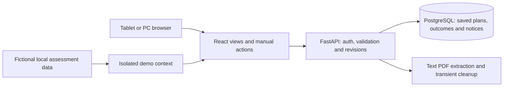
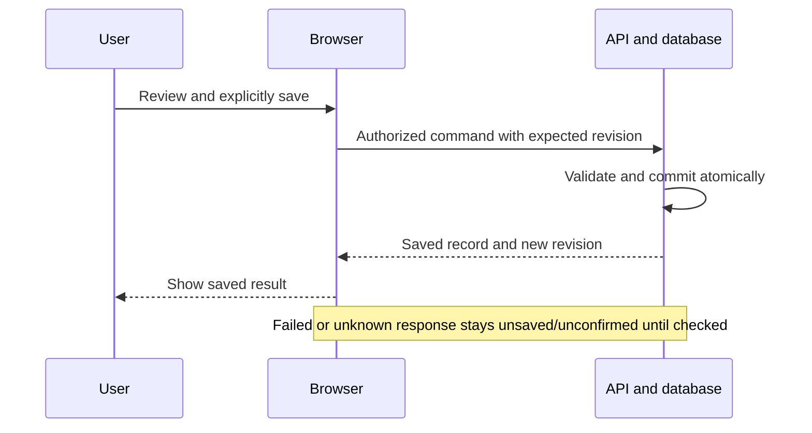

# SCOPE-02 — Deliver a smaller, testable driver assistant

## 1. Issue summary and evidence

The instructor's [feedback dated 6 October](briefs/brief-IBE160-2026-09-21/tilbakemelding-product-brief.md) identifies delivery scope as the main problem. The problem definition, real driver involvement and honest failure behavior are strengths. The requested response is a smaller first version, functional acceptance criteria, representative PDF fixtures and early implementation.

This proposal responds to that feedback. Jonas selected batch review and explicitly approved the complete SCOPE-02 proposal on 19 October 2026. Decisions S02-A–G are adopted. The coordinated brief, PRD, architecture, UX and active backlog now implement this replacement contract. Approval and document checks are not application implementation or test results.

### Verified planning baseline

| Evidence | Finding and implication |
|---|---|
| [Canonical epics](epics.md), heading inventory and individual [story drafts](story-drafts/) | Exactly 80 stories: E1 4, E2 12, E3 15, E4 8, E5 13, E6 10, E7 6, E8 12. All are approved plans, not implemented features. |
| [PRD](prds/prd-IBE160-2026-09-21/prd.md), sections 5–10 | Automatic retrieval, GPS progression, continuity, summary/export and field evaluation are mandatory in the current plan. Simply removing a few stories would leave contradictory acceptance requirements. |
| [Architecture](architecture/architecture-IBE160-2026-09-23/ARCHITECTURE-SPINE.md), AD-2/5/9–14 | Offline local authority, synchronization receipts, day grants, device transfer, retention and compatible releases create substantial work even before the visible driver features. |
| [EXPERIENCE](ux-designs/ux-IBE160-2026-09-22/EXPERIENCE.md), UJ-3/UJ-4 and revision flows | Mentor roles, linked persons, split-day revisions and takeover are additional V1 commitments beyond the original brief. |
| [Readiness report](implementation-readiness.md) | September's conditional PASS concerns the old plan. TIME-01 policy was resolved; its tests remain unexecuted. It is inaccurate to describe that policy as still undecided. |
| Repository inventory and [development log](../../Docs/development-log.md) | Documentation, planning and mockups are present. No application implementation or sprint-status file was found. No completed application work needs rollback. No repository AGENTS.md or project SPEC was found. |
| Owner clarification, 19 October | Remaining effort of 60–80 hours is considered realistic, including a holiday week that may supply approximately 40 hours. Delivery is expected in December; the exact date remains unknown. The older 40–160-hour range is not the current budget. |

**Correction to the feedback's baseline:** speed limits are already optional in PRD section 5 and excluded from the architecture's V1 integrations. The original brief still suggests first-version speed support. Align that brief; do not count speed removal as a reduction in the existing 80-story backlog. PDF export is an older product requirement, not a feature originally introduced by TIME-01.

**Trigger type:** stakeholder feedback on feasibility and acceptance, before implementation. There is no triggering implementation story or failed production deployment.

## 2. Recommended scope and path forward

Choose **MVP review with coordinated artifact revision**, followed immediately by bounded implementation. Preserve the useful preparation workflow and the fullstack/database requirement. Make completion of this smaller scope the course delivery target.

### Approved required V1

1. Import supported text-based Selfservice PDFs into an explicitly unconfirmed draft. Use 3–5 anonymized examples with checked expected results to establish the supported layouts first. Unsupported/scanned input has a visible failure/manual-entry path.
2. Inspect, directly correct, add, remove and order draft trips/activities; confirm the result before use. Preserve known dates, times, locations, route and direction. Unknown values remain unknown. No timetable integration is required.
3. Enter and correct the actual physical bus separately from vehicle duty. Show the ordered day with reporting time, trips, breaks, bus changes and transfers.
4. Select a trip/activity manually, including previous/next and direct choice. Display the selected route, destination and planned times. Selection is not observed location or proof of completion. No next-stop claim is made without a separate future stop-data feature.
5. Provide a simple list of planned notices for the day's lines. For this V1, notices are manually maintained with source links and metadata, then filtered by explicit line tags and applicable dates. Label them as manually maintained; do not claim automatic Svipper coverage or precise current-trip relevance.
6. Save confirmed work through the actual frontend, backend and database; reopen it while the server is reachable. Provide explicit end/abort and a small read-only recap of manual outcomes. PDF export is deferred.
7. Provide a resettable local fictional demo and a documented fullstack assessment path, requiring no paid account, external feed, GPS or real shift file at runtime. Keep demo and private records isolated.
8. Include basic private access, transient uploaded originals, bounded retention, readable tablet/PC views and truthful failure states. Reduced scope does not remove protection for retained private data.

### Explicit decisions adopted by the owner

| ID | Decision and tradeoff |
|---|---|
| S02-A | Manual activity navigation replaces GPS and automatic stop progression for V1. The product is primarily for preparation and consultation while stopped. It makes no speed sensing, movement-lock or live driving-support claim. This reduces continuous assistance during a trip. |
| S02-B | A manually maintained, source-linked line/date notice list replaces mandatory automatic retrieval and exact trip/stop matching. This explicitly supersedes the earlier “manual entry cannot replace automatic retrieval” decision for course V1. Manual upkeep and source checking count toward information-checking time; the old time-saving target may not be achieved. |
| S02-C | Online server persistence replaces full-day offline execution and cross-device recovery. No offline activation, private IndexedDB store, outbox, day grant or service-worker recovery is promised. This removes the need for TIME-01's disconnected-time mechanism in this version, while retaining access, expiry and deletion rules for the simpler storage model. |
| S02-D | Text PDF support is mandatory within a qualified fixture envelope. Scanned PDF, JPG/PNG, OCR, dated timetable enrichment, mid-day file reconciliation and linked-person plans move to the deferred backlog. Unsupported input must remain usable through manual entry, without being counted as successful PDF extraction. |
| S02-E | FADDER and operational INSTRUKTØR, person switching and takeover are deferred. The course assessor's fictional demo remains required and is a different concept. |
| S02-F | A short on-screen recap replaces the detailed daily evidence report and PDF export. Three actual workdays and the old E8-P/E8-E gates become a later operational evaluation track, not course V1 acceptance prerequisites. No real-shift permission is implied by this proposal. |
| S02-G | Retain the chosen React/TypeScript, FastAPI and PostgreSQL stack. Make a local reproducible fullstack run the required delivery route. Cloudflare, external hosting, desktop noise qualification and long-lived offline release compatibility are deferred. Actual dependency versions must be verified and pinned during bootstrap; old planning version numbers are not newly verified here. |

**Included quality boundary:** large, labelled controls, planned/manual/unknown distinctions, no fabricated completion, source time distinct from entry/retrieval time, private/demo isolation and applicable IR-01 contrast/focus rules remain. Manual Day/Night may reuse the accepted palettes; sensor-driven Auto, audio, wake lock and driving-specific display timing are deferred.

**Preserve ordinary data, defer advanced workflows:** a single chronological plan may contain breaks or separated work periods. Do not invent a continuous shift, overwrite a later depot with the first depot or discard a valid activity merely because advanced split-shift revision tools are deferred. Edit the plan before confirmation; after activation permit selection, bus correction, explicit outcomes and ending, rather than importing and reconciling another plan.

### Alternatives considered

| Option | Effort and risk | Decision |
|---|---|---|
| Direct adjustment inside the current eight epics | High delivery risk: automatic sensing, offline authority and mentor dependencies survive small story cuts. | Insufficient on its own. Use direct edits only to implement the approved smaller contract. |
| Roll back completed implementation | Not applicable: no application implementation found. Deleting approved planning history would reduce traceability. | Preserve old decisions and stories as a historical baseline. |
| Reduce V1 and rewrite affected requirements together | Medium planning effort; substantially fewer external and device dependencies. PDF feasibility remains the principal technical risk. | Recommended. |
| Keep automatic notices as a V1 requirement | Greater product value, but source access, coverage, identity and relevance qualification remain unproven. | Optional alternative for owner revision, not included in this estimate. If chosen, first timebox a source check and remove equivalent scope before committing it. |

### Effort and sequencing within 60–80 hours

These are rough planning estimates for the reduced scope, including integration and corrections, not measured velocity or a completion guarantee. The new stories are small slices; their count is not an effort estimate.

| Work package | Indicative hours |
|---|---:|
| Synchronize the approved plan; assemble/check fixtures and run the early PDF feasibility check | 4–6 |
| Runnable local fullstack slice, private access and persisted draft | 8–10 |
| Qualified text PDF import, correction, confirmation, bus and day overview | 12–16 |
| Manual navigation, explicit outcomes and small recap | 6–8 |
| Manually maintained notices and transparent line/date filtering | 4–6 |
| Integrated tests, privacy checks, UI checks, clean-machine README and evidence | 10–12 |
| Reserved for defects, unsupported layouts and delivery problems | 12–16 |
| **Total planning range** | **56–74** |

Plan against approximately 60 hours first. Up to 80 hours may be available, but the extra time is not preallocated to extensions. Preserve at least 12 hours for correction and final delivery. Review actual remaining work after the first 8–10 hours and again at approximately 30 hours.

The PDF experiment itself is timeboxed to roughly 3–4 hours within the first package. Report success, partial support or failure per fixture. If a useful supported set cannot be extracted without silent loss, return with measured evidence and a narrower input contract; do not silently declare manual entry equivalent to passing PDF import. If foundational work already exceeds its range, revise the estimate before consuming the testing reserve.

Suggested order: fixture investigation → first persisted fictional day → import/correction → confirmed overview → manual navigation → basic notices → integrated acceptance and delivery. Build the runnable demo from the first vertical slice. Exact calendar dates depend on the still-unconfirmed deadline and holiday week.

### Later increments

After V1 passes and capacity is reassessed: (1) qualify one automatic notice source and dated timetable data; (2) qualify GPS trip/stop progression on the actual tablet with explicit interaction behavior; (3) consider speed information only after its source and positioning feasibility are known. Offline continuity, mentor roles, advanced revisions and PDF export remain separate deferred candidates. No automatic promise to deliver these this semester.

## 3. Impact across epics, stories and implementation

| Current epic | Disposition | Replacement responsibility |
|---|---|---|
| E1 — access/drafts, 4 stories | Simplify; remove local outbox and pending offline logout machinery. | Basic private online access and server-persisted draft. |
| E2 — prepare/revise, 12 | Keep text import, correction, confirmation and overview; defer OCR, transit matching and advanced revisions. | Small supported input envelope and manually checked plan. |
| E3 — actual trip, 15 | Replace sensing/progression with manual activity selection; retain physical-bus distinction and honest outcomes. | Manual navigation and simple activity view. |
| E4 — notices, 8 | Redefine scope, not merely implementation technique. | Manual source-linked notice records and line/date list. |
| E5 — continuity, 13 | Defer the epic's offline/device-transfer capability. | Basic failed-save/reload behavior lives with the online functions. |
| E6 — mentor, 10 | Defer in full. | No linked persons or role-dependent operational engine. |
| E7 — closure/report, 6 | Retain explicit closure, small recap and expiry; defer PDF and elaborate evidence settlement. | Manual outcomes, terminal end/abort and bounded retention. |
| E8 — demonstration/qualification, 12 | Keep reproducibility/fullstack evidence, re-scope failures and quality checks; defer operational pilot/hosting qualification. | Local assessment, real integration tests and clear limitations. |

**Technical consequence:** retain one browser frontend, one backend and PostgreSQL. The backend becomes authoritative for saved state. Remove the local operational engine's GPS/role/time-grant responsibilities and its synchronization protocol from the new V1 architecture. Keep validation, transactional writes, stable record IDs and a lightweight revision check so a stale tab cannot silently overwrite a newer edit. Failed saves are not shown as successful; retry/reload must not duplicate a confirmed day or closure. No distributed offline event infrastructure is needed for that behavior.

No existing code, database, deployed service or release needs migration or rollback based on repository evidence. If implementation exists elsewhere, inspect it before applying this conclusion there.

### Proposed replacement backlog: four epics, 20 bounded stories

IDs below are deliberately new. They do not reuse old IDs with different meanings. Each feature includes its own validation, access and error behavior; later verification stories do not defer those obligations.

| Epic / ID | User outcome and minimum acceptance | Dependency |
|---|---|---|
| V1-E1 / V1-01 | **Establish supported imports:** 3–5 anonymized PDFs with independently checked expected activities, dates and uncertainty; record exact/partial/unsupported extraction and a pass/fail decision. | None |
| V1-E1 / V1-02 | **Run a persisted fictional day locally:** documented local startup opens the frontend; a real API saves/reads a fictional day in PostgreSQL and preserves it after service restart. | None |
| V1-E1 / V1-03 | **Access private work:** provisioned private login/logout, server authorization, no public signup and no demo access to private records. Session expiry requires sign-in without changing saved data. | V1-02 |
| V1-E1 / V1-04 | **Save and reopen a draft:** validated activities and explicit service/calendar dates survive reload; stale revision is rejected visibly; draft expiry and no-store private responses apply from introduction. | V1-03 |
| V1-E2 / V1-05 | **Review a text PDF:** supported files produce an unconfirmed draft with page/field uncertainty; original/temporary files are transient and cleaned after success/failure/cancel, including interrupted-job cleanup. | V1-01, V1-04 |
| V1-E2 / V1-06 | **Correct the draft:** edit/add/remove/order trips and other activities; unresolved fields remain visible, invalid times are rejected and cancelling leaves saved data unchanged. | V1-04, V1-05 |
| V1-E2 / V1-07 | **Confirm the reviewed plan:** explicit review/confirmation creates one saved confirmed plan; errors/duplicate clicks cannot activate a partial or duplicated plan. Required route/time facts must be resolved or explicitly unknown where permitted. | V1-06 |
| V1-E2 / V1-08 | **Record the physical bus:** manual entry/correction preserves route and vehicle duty; imported Vogn never becomes an assumed physical bus. | V1-07 |
| V1-E2 / V1-09 | **Read the day:** reporting time and ordered trips/breaks/transfers/bus changes match the confirmed plan; separate known parts/locations and overnight dates remain visible. | V1-07, V1-08 |
| V1-E3 / V1-10 | **Choose the intended activity:** direct and previous/next selection distinguish lines 20/24 and direction; selection persists online and never advances by clock or changes completion status. | V1-09 |
| V1-E3 / V1-11 | **Understand the selected activity:** show trip or non-passenger type, planned times and known places; missing stop data has no fabricated current/next stop. Boundary controls clearly show no previous/next. | V1-10 |
| V1-E3 / V1-12 | **Record outcomes and close:** manually mark completed/skipped/interrupted/unknown, confirm normal end or abort, then read a short recap. Cancel preserves the day; ending cannot silently complete remaining activities or resume afterwards. | V1-11 |
| V1-E3 / V1-13 | **Maintain a planned notice:** private editor stores title, explicit line tags, source URL, nullable source update/validity and separate entered/checked-at time; demo uses fictional records. | V1-03 |
| V1-E3 / V1-14 | **Read line/date notices:** show each applicable notice once with all matching lines; separate incidents remain separate; unknown validity is qualified and no entries does not mean no disruptions. No current-stop matching claim. | V1-09, V1-13 |
| V1-E3 / V1-15 | **Recover from an unavailable server:** show unsaved/unavailable status, preserve current form input while the page remains open, reconcile a retry with server state and reopen the last saved revision when connected. No offline restart guarantee or silent lost-save claim. | V1-04, V1-12, V1-14 |
| V1-E4 / V1-16 | **Enforce the retained-data boundary:** end-to-end expiry and deletion across drafts, plans, outcomes and associated private notices; no uploaded originals in logs/caches/repository. Late/stale requests cannot recreate expired work. | V1-05, V1-12, V1-13 |
| V1-E4 / V1-17 | **Repeat a fictional assessment:** reset fictional data and exercise import uncertainty, missing metadata and failed save without network services or geolocation. Reset cannot affect private data. | V1-12, V1-14, V1-15 |
| V1-E4 / V1-18 | **Use the included views on tablet and PC:** labelled controls, keyboard focus, manual Day/Night, text enlargement and applicable IR-01 contrast across actual states; record actual browser/device limitations. | V1-09, V1-11, V1-14 |
| V1-E4 / V1-19 | **Verify the complete user flow:** real PostgreSQL integration plus browser flow from supported PDF through corrections, saved plan, manual selection, notices, closure and reload; include failures and independent expected data. | V1-15, V1-16, V1-17, V1-18 |
| V1-E4 / V1-20 | **Deliver a reproducible submission:** test README from a clean local environment, bundle fictional fixtures and test evidence, describe AI use/limitations and trace implemented requirements to tests. | V1-19 |

V1-01 and V1-02 are independent starting tasks. This is sequencing flexibility, not a request for parallel agents. Privacy rules are implemented as data is introduced; V1-16 verifies the complete lifecycle. V1-15 collects integrated recovery behavior already required in each save path.

## 4. Specific artifact edits proposed

### 4.1 Product brief and supporting addendum

Targets: [product-brief.md](briefs/brief-IBE160-2026-09-21/product-brief.md), its identical [brief.md alias](briefs/brief-IBE160-2026-09-21/brief.md), and [addendum.md](briefs/brief-IBE160-2026-09-21/addendum.md). Keep both brief copies identical. Retain historical evidence and identify superseded scope explicitly in the addendum.

**Section: First-version scope — OLD:** automatic actual-progress following, relevant current-trip deviations, desired speed limits and real-shift evaluation are part of the first-version description.

**NEW proposed replacement:**

> The course V1 is a tablet-adapted fullstack website with a database. A driver imports a supported text-based Selfservice PDF, reviews and corrects its interpretation, enters the physical bus and confirms a chronological day overview. The driver selects trips and other activities manually. A manually maintained list shows planned notices for the day's lines with original-source links and explicit metadata. Selection and planned times are not observed location or completion. A fictional local demo demonstrates the full flow without live feeds, real shift data or GPS. Automatic notice retrieval, timetable enrichment, GPS progression, speed information, offline execution, mentor roles, advanced plan revisions and PDF export are later increments.

**Section: Trust and failure behavior — OLD:** failure rules chiefly concern automatic trip detection, retrieval and speed limits.

**NEW:** require explicit import confirmation, visible missing/uncertain fields, manual provenance, source/entry-time separation, honest failed-save and stale-data states, and unknown completion. Keep automatic-feature failure principles as future constraints, not implemented V1 claims.

**Sections: Value and success criteria; Feasibility — OLD:** three actual shifts and halved checking time lead acceptance; 40–160-hour historical capacity.

**NEW:** lead with the functional acceptance table below and an executable local fullstack demo. Preserve 10–15 minutes as an unproven longer-term hypothesis, counting manual notice maintenance. Three actual shifts require a separately scoped operational evaluation. Record the owner's current 60–80-hour estimate and the unresolved December deadline.

**Reason:** align the brief with actual delivery scope and make success testable without claiming live usefulness from a demo.

### 4.2 PRD changes, preserving requirement traceability

Target: [prd.md](prds/prd-IBE160-2026-09-21/prd.md). Sections 1–3 must describe the new approval/version, stationary preparation/manual consultation journey and no-login fictional assessment journey. Section 5 must explicitly record S02-A–G as supersessions. Keep original FR IDs in a change register; do not silently renumber their history.

| Section / old requirement | OLD contract, condensed | NEW V1 contract / rationale |
|---|---|---|
| FR-1 | 14-day session plus bounded day grant and offline continuation | Basic online private sign-in with fixed 14-day session and explicit logout; expired session requires sign-in, with no day-grant exception. No public registration; demo isolation retained. |
| FR-2 | PDF, later expanded to image/OCR import | Qualified text PDF, editable uncertainty and explicit confirmation; unsupported/scanned input has manual fallback. |
| FR-3 | Service-date transit lookup and stop-list recovery | Defer external lookup. Preserve entered service/calendar date and route/endpoints/time; missing stops remain unavailable. |
| FR-4 | Correct non-passenger activity facts | Retain type, times, optional location and explicit unknown codes; do not infer Travel to as pilot car. |
| FR-5 | Whole-day overview and physical bus | Retain for a single confirmed chronological plan. Show separate work periods without advanced revision workflow. |
| FR-6 | Automatic initial trip with manual override | Explicit manual selection only. Clock and proximity never select another trip. |
| FR-7–9 | Three-stop view, ≤100 m progression, GPS loss/manual stop correction | Defer stop progression and its controls. Selected trip/activity is the visible focus. |
| FR-10 | GPS/manual final-stop timing and return-trip triggers | Manual next/previous activity; no ten-second timer or inferred arrival/return. |
| FR-11 | Operational submenu with movement restrictions | Retain manual trip selection, explicit outcome, bus correction and end/abort for stopped use. |
| FR-12 | Required automatic retrieval and trip/stop relevance | Manual source-linked records with line/date filtering. Explicitly withdraw the automatic-retrieval V1 acceptance rule. |
| FR-13 | Source validity/update vs successful retrieval | Retain nullable source facts; distinguish manually entered/checked time. No fake retrieval timestamp for a manual record. |
| FR-14 | Versioned seen/hidden/ended lifecycle and ten-minute removal | Simple editable current notice records; no seen/acknowledged lifecycle or auto-ending claim. Explicit status/validity only. |
| FR-15 | New-notice chime | Defer audio entirely. |
| FR-16 | Sensor-based interaction policy with startup/outage exceptions | Defer sensing and lock timers. V1 interaction is intended while stopped and does not claim to enforce standstill. No required use while driving. |
| FR-17–18 | Whole-shift offline use, refresh and synchronization | Online saves only, explicit server-unavailable/unsaved states and deliberate retry/reload. No promise of offline private persistence. |
| FR-19 | Initial retrieval failure vs no notices | Distinguish unavailable list, no manually registered notices and uncertain freshness; offer original-source access where present. |
| FR-20 | Active-day offline restart recovery | Recover last server-saved state after online authentication; unsaved form content may be lost on page closure. State this limitation before it matters. |
| FR-21 | Explicit normal end/abort with inferred depot entry | Retain explicit confirmation and terminal closure; remove depot detection prerequisite. |
| FR-22 | Detailed inferred/manual day evidence report | Small read-only recap of plan, explicit manual outcomes and unknowns; no inferred completion or driver score. |
| FR-23 | Mandatory local offline PDF export capability | Deferred, including marked rejected-activation PDF variants. |
| FR-24 | Seven-day all-copy retention with offline Tg/D rules | Server-based non-sliding expiry: drafts expire seven days after creation; confirmed plans no later than planned final end plus seven days or verified server end/abort plus seven days, whichever is earlier. Reject expired access immediately and purge at startup/periodically. Delete originals after processing; no persistent private client copy. |
| FR-25 | Fictional GPS/speed/network simulation and export | Local fictional import/manual-navigation/notice/save-failure scenarios, reset and explicit demo label; no sensor simulation required. |

For FR-24, derive timestamps on the server. Once confirmed, the planned-end retention bound is fixed in this V1; actions cannot extend it. Unresolved end dates must be corrected before confirmation. Session logout/expiry clears private application memory; private API/browser responses use no-store and back navigation must not reveal a stale private view. Do not claim forensic erasure or exact physical disk wiping. Ordinary database storage and the existing no-historical-private-backup constraint remain; no new archival feature is introduced.

Manually maintained private notices are day-associated or receive a fixed, visible short retention deadline; no unbounded private notice archive is created. Fictional fixtures and public source facts have separate explicit lifecycles and must not contain private day associations.

**NFR-1–4:** retain tablet/PC readability, applicable IR-01 values, information integrity, private/demo separation and actual verification of included browser functions. Remove mandatory GPS/audio/offline/Auto/PDF measurements when those functions are out of scope. This is a smaller test surface, not a claim that old gates passed.

**Sections 8–10:** preserve old research as historical feasibility candidates; rewrite SM-3/SM-4 for manual navigation and saved fullstack flow. Make SM-1/SM-2 field benefit hypotheses and SM-5 reproducible assessment acceptance. Replace the downstream validation list with qualified text extraction, actual CRUD/database behavior, notice semantics, included UI checks and delivery reproducibility. Record the still-open exact date/environment facts.

Update the [PRD addendum](prds/prd-IBE160-2026-09-21/addendum.md) and its decision reconciliation with SCOPE-02 precedence, preserving historical decisions rather than presenting them as current scope.

### 4.3 Architecture changes and replacement diagrams

Target: [ARCHITECTURE-SPINE.md](architecture/architecture-IBE160-2026-09-23/ARCHITECTURE-SPINE.md).

| Decision / section | OLD → proposed NEW |
|---|---|
| Design paradigm and V1 boundary; AD-1 | Modular monolith remains; narrow boundaries to PDF import and the actual web/API/database path. Defer hypothetical transit/source ports until needed. |
| AD-2 | Client operational authority + IndexedDB/outbox → server-saved plans and UI form state; no private persistent offline cache. |
| AD-3–4 | Retain React/TypeScript + FastAPI + PostgreSQL; validate and pin actual compatible dependencies at bootstrap. |
| AD-5 | SyncBatch/SyncReceipt/epochs → direct validated transactional operations, stable IDs and revision checks; explicit retry/unknown-save handling. |
| AD-6 | Text extraction and OCR → qualified text extraction only, editable ImportDraft and transient originals. Retain interrupted-process cleanup. |
| AD-7 | Entur day bundles and central automatic notice ingestion → no transit preparation; manual notice records with explicit line/date tags. |
| AD-8 | Source version engine + seen/hidden lifecycle → simple provenance/status/validity fields; no automatic closure/version inference. |
| AD-9 | GPS/role/movement state machine → small explicit draft/confirmed/active/ended/aborted lifecycle with manual selection/outcomes. |
| AD-10 | Sessions + active-day grants + offline locks → ordinary online sessions, logout, owner authorization and isolated demo. Preserve cookie/CSRF/origin protections; no new public operational access. |
| AD-11 | Writer transfer and offline merge → defer transfer; reject stale online edits without overwriting them silently. |
| AD-12 | All-copy Tg/deadline/closure settlement → bounded server-owned retention described above, transient inputs and no private client persistence. TIME-01 is historical for the deferred offline scope. |
| AD-13 | Mandatory five-service public/private tunnel deployment → local reproducible frontend/backend/database run. Public hosting is a separate later decision. Preserve isolated fictional assessment path. |
| AD-14 | Old-client compatibility until offline data expiry → controlled versioned local releases and database migration verification. Preserve saved data; no offline multi-build recovery system. |
| Contracts | Keep narrowed ImportDraft, Workday/Activity and Notice/SourceMetadata. Drop V1 OfflineBundle, SyncBatch/Receipt and linked-person/context contracts. |
| Gates | Replace five operational pilot gates as V1 acceptance prerequisites with the functional/local-delivery checks below; keep old gates with their deferred features. |

Replace the operational/outbox sequence and Cloudflare hosting diagram with these scoped diagrams:

The shared UI does not imply shared private data or authorization. Demo uses a separately configured fictional environment/store; the fullstack assessment path must exercise the real API and PostgreSQL using fictional records. A browser-only fixture demonstration alone cannot pass fullstack acceptance.

### 4.4 UX changes

Targets: [DESIGN](ux-designs/ux-IBE160-2026-09-22/DESIGN.md), [EXPERIENCE](ux-designs/ux-IBE160-2026-09-22/EXPERIENCE.md) and the affected mockup index/reference descriptions.

| Screen/component and OLD flow | NEW flow | Reason |
|---|---|---|
| Preparation: PDF/JPG/PNG → timetable matching → whole-day bundle | Text PDF → editable draft → explicit confirm → day overview | Keep the useful accepted preparation layout with fewer external dependencies. |
| Driving focus: dominant current/next stop, automatic progression | Selected trip/activity with route, destination, planned times and direct previous/next selection | No unsupported location or stop-progression implication. Reuse readable typography, not automatic semantics. |
| Meny, stop selector, GPS countdown and speed restrictions | Simple stationary-use navigation; no sensor lock/countdown/stop controls | Avoid retaining a fake safety/availability mechanism without GPS. |
| Notice detail and driving warnings with source versions/chime | Day-line list with manual-maintenance label, source metadata and editor | Match the reduced information contract. |
| Offline readiness, pending logout, device-transfer and TIME-01 screens | Explicit online/server-unavailable, unsaved, session-expired and retry states | Explain included behavior without unused recovery workflows. |
| Fadder/Instruktør and own/linked-person flows | Defer UJ-3/UJ-4 and associated role/person screens | Remove their plan, recovery and summary dependencies together. |
| Full/partial updated-file comparison and overtime reconciliation | Edit unconfirmed draft only; existing confirmed day remains unchanged by a new import | Remove ambiguous active-plan merge behavior. |
| Summary, PDF and varied closing bank | Small manual-outcome recap and neutral closure; no export | Maintain truthful completion without report generation. |
| Day/Night/Auto | Persistent manual Day/Night | Reuse approved palettes; defer automatic sensing. |
| Instructor GPS/speed/failure simulator | Fictional manual-navigation, import-error and save-error scenarios | Demonstrate included behavior repeatably. |

Preserve keyboard operation, focus return, error feedback and no color-only status. Mark old driving/mentor/offline/PDF mockups as future/historical references in the index; retain their files. The existing 43-screen acceptance does not transfer wholesale to the revised V1.

### 4.5 Story edits: OLD → NEW or deferred

The following disjoint groups account for every existing story exactly once. “Rewrite” means replace only the relevant user outcome with the named new story; it does not carry forward all old acceptance criteria/dependencies. “Defer” preserves historical content outside active V1. Reasons follow the scope decisions above.

| Existing story IDs | OLD responsibility | Proposed disposition and NEW target |
|---|---|---|
| 1.1 | Private fullstack sign-in | Rewrite → V1-02/03: ordinary online access and local startup. |
| 1.2 | Persistent pending offline logout | Defer; basic online logout belongs to V1-03. |
| 1.3–1.4 | Local draft/outbox and durable sync receipt | Rewrite → V1-04/15: server-persisted draft, revision checks and honest failed-save recovery. |
| 2.1 | PDF/OCR feasibility | Rewrite → V1-01: text-PDF fixtures/fasit first; unsupported OCR explicit. |
| 2.2 | Dated timetable feasibility | Defer external matching. |
| 2.3–2.4 | Draft editing and text PDF review | Rewrite → V1-05/06, retaining field uncertainty and cleanup. |
| 2.5–2.6 | Scanned/image import and timetable matching | Defer. |
| 2.7 | Initial plan confirmation | Rewrite → V1-07/08/09 with bus and overview, without offline bundles. |
| 2.8 | Whole-day transit preparation | Defer. |
| 2.9 | Advanced combined split-day preparation | Defer dedicated workflow; V1-09 still displays all confirmed activities and distinct times/places. |
| 2.10–2.12 | Extra-work/file revision comparison and atomic application | Defer active-plan revision; V1-06 handles unconfirmed edits only. |
| 3.1–3.2 | GPS qualification and movement policy | Defer; V1 explicitly avoids sensed movement claims. |
| 3.3 | Selected trip/manual pin | Rewrite → V1-10: explicit manual selection, no sensor engine. |
| 3.4 | Automatic initial selection | Defer. |
| 3.5 | Three-stop view | Rewrite → V1-11: selected activity and known planned facts only. |
| 3.6–3.9 | GPS advance/manual stops/recovery/final-stop triggers | Defer. |
| 3.10–3.11 | Non-passenger and missing-stop behavior | Rewrite → V1-11: manual activity display with unknowns. |
| 3.12 | Interrupted/skipped work | Rewrite → V1-12: explicit manual outcomes separate from selection. |
| 3.13 | Physical bus replacement | Rewrite → V1-08: bus correction without trip/duty reassignment. |
| 3.14 | Manual and Auto theme | Rewrite → V1-18: manual Day/Night and included UI checks only. |
| 3.15 | Wake lock | Defer. |
| 4.1–4.3 | Automatic source qualification/retrieval/version engine | Defer; V1-13 explicitly provides manual notice records, not equivalent automatic behavior. |
| 4.4–4.5 | Precise relevance and persistent version-aware list | Rewrite → V1-14: line/date candidate list with provenance and uncertainty. |
| 4.6–4.8 | Staged driving warnings, acknowledgement/hiding and sound | Defer. |
| 5.1–5.5 | Day grants, offline assets/resume/start and Access lifetime | Defer. |
| 5.6 | Offline synchronization/source recovery | Rewrite → V1-15: online save status and deliberate retry only. |
| 5.7–5.13 | Offline conflicts, device transfer, compatibility and final settlement | Defer; ordinary stale-edit rejection remains in V1-04/15. |
| 6.1–6.10 | All mentor/linked-person workflows | Defer entirely. |
| 7.1–7.3 | Day closure, initial review and detailed evidence summary | Rewrite → V1-12: terminal manual closure and small read-only recap. |
| 7.4 | Offline PDF export | Defer. |
| 7.5–7.6 | Retained summary and varied factual closing | Rewrite → V1-12/16: bounded read-only recap and neutral closing. No greeting bank. |
| 8.1–8.3 | Fictional demo, failure simulation and fullstack evidence | Rewrite → V1-02/17/19: included functions, isolated fixtures and actual database integration. |
| 8.4 | Portable hosted service stack | Rewrite → V1-02/20: local reproducible runtime and database restart evidence. |
| 8.5 | External protected ingress | Defer public/private hosting; local private/demo denial checks remain required. |
| 8.6 | Assessable course delivery | Rewrite → V1-20: clean local run, evidence, limitations and AI reflection. |
| 8.7 | Operational import/source qualification | Rewrite → V1-01/19: supported fixture extraction and manual metadata/filtering tests. Live-source qualification deferred. |
| 8.8 | Mounted GPS/driving/Auto/audio qualification | Rewrite → V1-18: included tablet/PC views, contrast, keyboard and manual theme only. |
| 8.9–8.12 | Whole-day recovery, host/releases, pilot decision and three-shift trial | Defer operational qualification/evaluation; basic persistence/restart is tested in V1-02/19. |

**Concrete acceptance replacement examples:**

- **Story 3.3, selection criteria:** OLD — pin a manual trip within a qualified actual-progress tracking context. NEW (V1-10) — given a confirmed day containing distinct line 20/24 trips, selecting one persists that exact activity; elapsed scheduled time and reopening do not select another; previous/next never marks an activity completed.
- **Story 4.4, relevance criteria:** OLD — assess route/direction/stops/validity against actual context. NEW (V1-14) — given a notice tagged 20 and 24 valid on the service date, list it once with both matching lines; retain a separate incident on line 20; unknown validity is labelled uncertain. No exact-stop/current-trip precision is asserted.
- **Story 5.6, recovery criteria:** OLD — reconcile independent access/source/sync states while authorized offline work continues. NEW (V1-15) — if a save response is lost, show unresolved save status; check the server's stable record/revision before retrying, without creating a duplicate or claiming that an unacknowledged edit is saved.
- **Story 7.1, ending criteria:** OLD — settle terminal local state, pending batches and accompanied-plan trimming under TIME-01. NEW (V1-12) — an explicit authorized online end/abort transaction saves terminal status and server time once; a repeated action is harmless; unresolved outcomes stay unknown; cancellation does not close the day.

### 4.6 Secondary artifacts and historical status

After approval, update canonical epics, all affected individual story dispositions, the scope/supersession register, source addenda and the development log together. Preserve old approvals as historical facts; new stories require their own acceptance evidence. Archive or prominently mark the old 80-story baseline so agents cannot mistake it for the active build queue.

Mark [epics-final-validation.md](epics-final-validation.md) and [implementation-readiness.md](implementation-readiness.md) as validation of the September baseline, superseded for active-scope selection once SCOPE-02 is adopted. Generate a new brief readiness result against the revised plan. Do not carry the old conditional PASS into new requirements without checking them.

No sprint-status.yaml currently exists. After revised epics/story IDs are consistent and the new readiness check passes, generate tracking for the 20 new stories as backlog. Do not create an 80-story tracking file from the old plan or mark deferred work done. Keep the previous [TIME-01 proposal](sprint-change-proposal-2026-09-27.md) as history, with a pointer to its narrower applicability under SCOPE-02.

README must lead with the local fictional fullstack path, prerequisites/start/reset/test commands and supported PDF layouts. It must state online-only saved-state behavior, manually maintained notices and deferred features. No credentials, operational originals or claims of unperformed field tests belong in submission evidence.

## 5. Functional acceptance and implementation handoff

### Functional acceptance layer

These are proposed acceptance requirements. Fixtures and executable tests have not been created or run by this workflow.

| ID | Given / expected result | Evidence |
|---|---|---|
| AC-01 | For each of 3–5 checked PDFs, extract the expected activities and known fields in the right order; missing/uncertain fields are explicit. Report extraction fidelity separately from the final corrected plan. | Versioned anonymized fixtures, independent expected JSON/table and automated comparisons. Include one/two-column or multi-page layouts where available. Unsupported categories are reported, not counted as passes. |
| AC-02 | Correct an erroneous time, add an omitted break and distinguish Vogn from physical bus; confirm and reload. Saved overview equals the reviewed expected result. | API/database and browser tests with fixed expected data. |
| AC-03 | Adjacent trips on 20/24, opposite directions and dates across midnight remain distinct. Selecting next/previous changes selection only; no clock-driven or fabricated completion. | Deterministic domain/browser cases, including list boundaries. |
| AC-04 | A notice covering 20 and 24 appears once; separate events remain separate. Known validity filters by date; unknown validity/source time is labelled. Manual checked-at never substitutes for source-update time. | Table-driven notice fixtures and UI assertions. |
| AC-05 | No registered notices, unavailable backend and stale/unknown manually checked information are distinguishable; none claims a clear route. | Failure and empty-data scenarios. |
| AC-06 | Invalid PDF, unsupported scan and interrupted upload preserve the existing confirmed plan, provide manual correction/entry and clean transient originals. | Import-failure/cleanup tests, including process interruption. |
| AC-07 | Failed, stale and response-lost saves cannot silently overwrite or duplicate a plan/end action. Reconnect and reload show the last acknowledged saved result or explicitly resolve uncertainty. | Real PostgreSQL transaction/revision tests and browser failure scenario. |
| AC-08 | End/abort requires explicit confirmation; cancel retains state, unresolved work remains unknown and ended work cannot resume. | Terminal-state and retry tests. |
| AC-09 | Unauthenticated/private-cross-owner/demo requests cannot read or mutate private work. Logout and expiry deny access; expired records cannot be resurrected; no private persistent client cache or raw-file log remains. | Server denial, browser navigation/cache checks and lifecycle/cleanup tests. |
| AC-10 | All included views meet applicable IR-01 text/non-text/focus rules in manual Day/Night; keyboard navigation and tablet/PC layouts remain usable with long names and errors. | Actual rendered measurements and recorded browser/device observations. No PDF/Auto/GPS pass claimed. |
| AC-11 | A fresh local setup runs the real frontend/API/PostgreSQL path using fictional fixtures without API keys, private data or live feeds; demo reset is repeatable and isolated. | Executed README procedure, restart/persistence evidence and test output. Dependency downloads may be needed at setup; normal demo runtime does not require external services. |
| AC-12 | Delivered functionality, deferred requirements, failed/not-run tests and AI-assisted decisions are traceable from brief to new stories and evidence. | Delivery matrix and concise development/reflection log. |

The 10–15-minute information-checking target remains a hypothesis. A scripted demo cannot establish real source coverage, GPS performance, time saving or actual-shift usefulness. If later field work is approved, count manual notice preparation and source verification as part of the time, and report negative outcomes too.

### Handoff: major replan, then implementation

| Responsible role | Concrete responsibility | Completion condition |
|---|---|---|
| Jonas, product owner | Approve/revise S02-A–G; provide available anonymized PDFs/fasit and exact December deadline when known. | Explicit scope decision; fixture suitability and remaining capacity recorded. |
| Product manager / backlog owner | Apply brief/PRD/addendum edits and publish the 4-epic/20-story active backlog with old-to-new mapping. | No active requirement still mandates a deferred feature. |
| Architect | Replace offline/sensing/mentor contracts with the smaller server-persisted model; retain necessary access, cleanup and transaction behavior. | Architecture, API expectations and new story dependencies agree. |
| UX owner | Update included preparation/manual-navigation/notice/recap flows and mark unused mockups historical. | Every included state has a truthful usable flow; old automatic labels cannot leak into V1. |
| Developer / verification owner | Run the PDF timebox, build the first local fullstack slice and implement in dependency order with tests and short commits. | AC-01–12 have recorded results; failures are fixed or explicitly return for scope decision. |

These are responsibilities for subsequent work, not claims that other agents have been contacted or work delegated. Do not invoke a long planning cycle before the first implemented slice: apply the coordinated scope corrections, check consistency, then start V1-01/V1-02.

## 6. Workflow checklist and decision record

Status legend: [x] analyzed/completed for this proposal; [N/A] not applicable; [!] awaiting decision or later execution.

| Checklist items | Status | Finding / next action |
|---|---|---|
| 1.1 triggering story | [N/A] | External instructor feedback, before implementation. |
| 1.2–1.3 problem/evidence | [x] | Scope risk, 80 stories and current 60–80-hour estimate recorded. |
| 2.1 current triggering epic | [N/A] | No executing epic; assessment covers the whole planned delivery. |
| 2.2–2.5 epic changes, dependencies, remaining work and sequence | [x] | All eight epics and all 80 old story IDs mapped; four replacement epics and 20 stories proposed. |
| 3.1–3.4 PRD, architecture, UX and secondary artifacts | [x] | Before/after edits, diagrams, history/readiness and README consequences specified. |
| 4.1 direct adjustment | [x] | Evaluated; insufficient without scope reset. |
| 4.2 rollback | [N/A] | No application implementation found. |
| 4.3–4.4 MVP review and recommendation | [x] | Smaller manual/online V1 recommended with timeboxes and reserve. |
| 5.1–5.5 proposal and handoff | [x] | Issue, impacts, approach, explicit edits, acceptance and responsibilities documented. |
| 6.1–6.2 completeness and accuracy | [x] | Inventory/count/link/dependency checks recorded with proposal verification; no product test pass implied. |
| 6.3 explicit approval | [x] | Jonas explicitly approved the complete proposal on 19 October 2026, including S02-A–G. |
| 6.4 sprint status | [x] | Revised sources checked; tracking generated for four new epics and 20 backlog stories. No old story is marked completed. |
| 6.5 final handoff | [x] | Product/backlog, architecture and UX planning updates applied; developer handoff is the new backlog and sprint tracking. Implementation is not started. |

### Proposal verification — 19 October

Checked the canonical story-heading inventory against the old-to-new disposition table: 80 existing IDs, 80 mapped IDs, no missing, extra or duplicate mappings. The replacement table contains 20 story IDs; every declared dependency exists and points to an earlier slice. All local Markdown links resolve. At proposal review time no source-plan file had changed. After owner approval, the coordinated current sources were rewritten and earlier versions preserved as historical snapshots. These are documentation checks, not executed application, PDF extraction, source or field tests.

**Approval record:** Jonas approved the complete proposal on 19 October 2026. This includes manual notices, manual trip/activity navigation, online-only saved state, text-PDF scope, deferred mentor/PDF/field-evaluation features and the 20-story backlog.

**Current handoff state:** adopted and applied to planning sources. [Current epics](epics.md) and [implementation readiness](implementation-readiness.md) govern the build handoff. The stable V1-01–V1-20 aliases use numeric IDs 9.1–12.5, with epics 9–12 aliasing V1-E1–V1-E4, so the BMAD parser does not reuse old IDs. [Sprint tracking](../implementation-artifacts/sprint-status.yaml) begins with all 20 stories in backlog. No application implementation, product acceptance or operational pilot is claimed.
